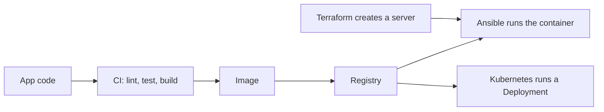

# DevOps Portfolio

One small app, carried through the tools a DevOps engineer uses
every day. Each folder adds one layer and can be run on its own.

## Folders

The app is a small FastAPI service with two endpoints, `/health` and `/version`. Every other folder works with that same app. Each folder has its own readme with the details.

| Folder | What it holds |
| --- | --- |
| [`app/`](app/) | The FastAPI app with `/health` and `/version`, and its tests. |
| [`01-linux-bash/`](01-linux-bash/) | Bash scripts that install and watch the app on a plain Linux host, tested in a container. |
| [`02-docker/`](02-docker/) | A multi-stage Dockerfile and a compose file that build and run the app image. |
| [`03-ci-cd/`](03-ci-cd/) | The readme for the GitHub Actions workflow in `.github/workflows/ci.yml`, which lints, tests, builds and pushes the image. |
| [`04-terraform/`](04-terraform/) | Terraform code for one EC2 server on AWS and its security group. |
| [`05-ansible/`](05-ansible/) | An Ansible playbook that prepares an Ubuntu server and runs the image on it. |
| [`06-kubernetes/`](06-kubernetes/) | Kubernetes manifests that run the image as a Deployment with two pods behind a Service. |

## From code to a running container

This is the path the folders are built for. The readmes in the numbered folders say which parts I ran and which I did not.



In every check here the app image was built on my machine. For the Kubernetes check I imported it from the local Docker image store.

## How to run

All commands run from the repo root. I ran them in PowerShell on Windows 11 with Docker Desktop. The readmes in the numbered folders have the full steps and what the commands printed.

### app/

I ran these commands in a venv. The first line creates it, and the next three run the tests the way the CI test job does. The paths are written for PowerShell on Windows.

```
python -m venv .venv
.venv\Scripts\python -m pip install -r app/requirements-dev.txt
cd app
..\.venv\Scripts\python -m pytest
```

pytest printed `2 passed, 1 warning`.

Then start the app, still from `app/`. uvicorn runs until it is stopped, so it needs its own terminal. It uses port 8000 on the machine, the same host port as in the `02-docker/` section.

```
..\.venv\Scripts\python -m uvicorn main:app --host 127.0.0.1 --port 8000
```

In a second terminal:

```
curl -s http://127.0.0.1:8000/health
```

It printed `{"status":"ok"}`. After I stopped uvicorn, nothing listened on port 8000 any more. Then `cd ..` goes back to the repo root.

### 01-linux-bash/

```
docker run --rm --name pf-linux-bash -v "${PWD}:/repo:ro" -w /repo ubuntu:24.04 bash 01-linux-bash/verify.sh
docker run --rm --name pf-linux-bash-unit -e DEBIAN_FRONTEND=noninteractive -v "${PWD}:/repo:ro" -w /repo ubuntu:24.04 bash -c "apt-get update -qq && apt-get install -y -qq --no-install-recommends python3 python3-venv systemd >/dev/null && bash 01-linux-bash/setup.sh >/dev/null && systemd-analyze verify /etc/systemd/system/portfolio-app.service && echo unit file verified"
```

The first command runs `verify.sh`, which runs the other three scripts in an Ubuntu 24.04 container. It ended with `VERIFY PASSED`. The second command checks the systemd unit file, and it printed `unit file verified`. The folder readme also shows the commands for a real Ubuntu host and marks them as not run.

### 02-docker/

```
docker build -f 02-docker/Dockerfile -t portfolio-app:0.1.0 .
docker run -d --name pf-app -p 8000:8000 portfolio-app:0.1.0
curl -s http://127.0.0.1:8000/health
docker rm -f pf-app
```

`/health` answered `{"status":"ok"}`. The folder readme also has the compose way and a second version of the image.

### 03-ci-cd/

```
docker run --rm --name pf-ci-actionlint -v "${PWD}:/repo:ro" -w /repo rhysd/actionlint:1.7.12 -color
docker run --rm --name pf-ci-lint -v "${PWD}:/repo:ro" python:3.14.10-slim-trixie sh -c "mkdir /work && cp -r --no-preserve=mode /repo/app /work/app && cd /work/app && pip install --no-cache-dir ruff==0.17.4 && ruff check . && ruff format --check ."
docker run --rm --name pf-ci-test -v "${PWD}:/repo:ro" python:3.14.10-slim-trixie sh -c "mkdir /work && cp -r --no-preserve=mode /repo/app /work/app && cd /work && python -m pip install -r app/requirements-dev.txt && cd app && pytest"
```

These commands check the workflow file and run the lint and test jobs in clean Linux containers. The login and push steps need the token that only the workflow gets, so they are not among these commands.

### 04-terraform/

```
docker run --rm -v "${PWD}/04-terraform:/tf" -w /tf hashicorp/terraform:1.17.2 fmt -check -recursive -diff
docker run --rm -v "${PWD}/04-terraform:/tf" -w /tf hashicorp/terraform:1.17.2 init -backend=false -input=false
docker run --rm -v "${PWD}/04-terraform:/tf" -w /tf hashicorp/terraform:1.17.2 validate
```

`fmt` printed nothing, `init` printed `Terraform has been successfully initialized!` and `validate` printed `Success! The configuration is valid.` None of them needs AWS credentials. The folder readme also shows `terraform plan` and `terraform apply`, and marks them as not run.

### 05-ansible/

```
docker run --rm --name pf-ansible -v "${PWD}:/repo:ro" -w /repo ubuntu:24.04 bash 05-ansible/verify.sh
```

This command runs ansible-lint, the syntax check and the playbook in an Ubuntu 24.04 container, without the tasks that need a real server. It ended with `VERIFY PASSED`. The folder readme also shows the commands for a real server and marks them as not run.

### 06-kubernetes/

```
k3d cluster create portfolio --kubeconfig-update-default=false --kubeconfig-switch-context=false --wait --timeout 300s
k3d kubeconfig write portfolio --output 06-kubernetes/.kubeconfig
k3d image import portfolio-app:0.1.0 -c portfolio
kubectl --kubeconfig 06-kubernetes/.kubeconfig apply -f 06-kubernetes/
```

These commands create a local k3d cluster, import the image from the local Docker image store and apply the four manifests. The folder readme has the rest: the rollout check, the port-forward, the replaced pod and `k3d cluster delete portfolio`, which removes the cluster at the end.

---

# תיק עבודות `DevOps`

אפליקציה קטנה אחת, שעוברת דרך הכלים שמהנדס `DevOps` עובד איתם
כל יום. כל תיקייה מוסיפה שכבה אחת ואפשר להריץ אותה לבד.

## תיקיות

האפליקציה היא שירות `FastAPI` קטן עם שני נתיבים, `/health` ו-`/version`. כל שאר התיקיות עובדות עם אותה אפליקציה. לכל תיקייה יש קובץ `README` משלה עם הפרטים.

| תיקייה | מה יש בה |
| --- | --- |
| [`app/`](app/) | האפליקציה ב-`FastAPI` עם `/health` ו-`/version`, והבדיקות שלה. |
| [`01-linux-bash/`](01-linux-bash/) | סקריפטים של `Bash` שמתקינים את האפליקציה ומשגיחים עליה על שרת `Linux` רגיל, עם בדיקה בקונטיינר. |
| [`02-docker/`](02-docker/) | קובץ `Dockerfile` עם שני שלבים וקובץ `compose`, שבונים ומריצים את האימג' של האפליקציה. |
| [`03-ci-cd/`](03-ci-cd/) | ההסבר ל-`workflow` של `GitHub Actions` שב-`.github/workflows/ci.yml`, שבודק את הקוד, מריץ את הבדיקות, בונה את האימג' ודוחף אותו. |
| [`04-terraform/`](04-terraform/) | קוד `Terraform` לשרת `EC2` אחד ב-`AWS` ול-`security group` שלו. |
| [`05-ansible/`](05-ansible/) | קובץ `playbook` של `Ansible` שמכין שרת `Ubuntu` ומריץ עליו את האימג'. |
| [`06-kubernetes/`](06-kubernetes/) | קובצי `manifest` של `Kubernetes` שמריצים את האימג' בתור `Deployment` עם שני `pods` מאחורי `Service`. |

## מהקוד לקונטיינר שרץ

זה המסלול שהתיקיות בנויות בשבילו. קובצי ה-`README` בתיקיות הממוספרות אומרים אילו חלקים הרצתי ואילו לא.


בכל הבדיקות כאן האימג' של האפליקציה נבנה במחשב שלי. בבדיקה של `Kubernetes` ייבאתי אותו ממאגר האימג'ים המקומי של `Docker`.

## איך מריצים

כל הפקודות רצות משורש הריפו. הרצתי אותן ב-`PowerShell` על `Windows 11` עם `Docker Desktop`. בקובצי ה-`README` של התיקיות הממוספרות יש את כל הצעדים ואת מה שהפקודות הדפיסו.

### התיקייה `app/`

הרצתי את הפקודות האלה בתוך `venv`. השורה הראשונה יוצרת אותו, ושלוש השורות הבאות מריצות את הבדיקות כמו שמשימת ה-`test` של ה-`CI` מריצה אותן. הנתיבים כתובים בשביל `PowerShell` על `Windows`.

```
python -m venv .venv
.venv\Scripts\python -m pip install -r app/requirements-dev.txt
cd app
..\.venv\Scripts\python -m pytest
```

הכלי `pytest` הדפיס `2 passed, 1 warning`.

אחר כך מפעילים את האפליקציה, עדיין מתוך `app/`. הכלי `uvicorn` רץ עד שעוצרים אותו, ולכן הוא צריך טרמינל משלו. הוא תופס את פורט `8000` של המחשב, אותו פורט שגם החלק של `02-docker/` תופס.

```
..\.venv\Scripts\python -m uvicorn main:app --host 127.0.0.1 --port 8000
```

בטרמינל שני:

```
curl -s http://127.0.0.1:8000/health
```

הפקודה הדפיסה `{"status":"ok"}`. אחרי שעצרתי את `uvicorn`, אף תהליך כבר לא האזין על פורט `8000`. בסוף הפקודה `cd ..` מחזירה לשורש הריפו.

### התיקייה `01-linux-bash/`

```
docker run --rm --name pf-linux-bash -v "${PWD}:/repo:ro" -w /repo ubuntu:24.04 bash 01-linux-bash/verify.sh
docker run --rm --name pf-linux-bash-unit -e DEBIAN_FRONTEND=noninteractive -v "${PWD}:/repo:ro" -w /repo ubuntu:24.04 bash -c "apt-get update -qq && apt-get install -y -qq --no-install-recommends python3 python3-venv systemd >/dev/null && bash 01-linux-bash/setup.sh >/dev/null && systemd-analyze verify /etc/systemd/system/portfolio-app.service && echo unit file verified"
```

הפקודה הראשונה מריצה את `verify.sh`, והוא מריץ את שלושת הסקריפטים האחרים בקונטיינר `Ubuntu 24.04`. היא הסתיימה ב-`VERIFY PASSED`. הפקודה השנייה בודקת את קובץ ה-`unit` של `systemd`, והיא הדפיסה `unit file verified`. קובץ ה-`README` של התיקייה מציג גם את הפקודות לשרת `Ubuntu` אמיתי, ומסמן שהן לא הורצו.

### התיקייה `02-docker/`

```
docker build -f 02-docker/Dockerfile -t portfolio-app:0.1.0 .
docker run -d --name pf-app -p 8000:8000 portfolio-app:0.1.0
curl -s http://127.0.0.1:8000/health
docker rm -f pf-app
```

הנתיב `/health` ענה `{"status":"ok"}`. בקובץ ה-`README` של התיקייה יש גם את הדרך עם `compose` וגרסה שנייה של האימג'.

### התיקייה `03-ci-cd/`

```
docker run --rm --name pf-ci-actionlint -v "${PWD}:/repo:ro" -w /repo rhysd/actionlint:1.7.12 -color
docker run --rm --name pf-ci-lint -v "${PWD}:/repo:ro" python:3.14.10-slim-trixie sh -c "mkdir /work && cp -r --no-preserve=mode /repo/app /work/app && cd /work/app && pip install --no-cache-dir ruff==0.17.4 && ruff check . && ruff format --check ."
docker run --rm --name pf-ci-test -v "${PWD}:/repo:ro" python:3.14.10-slim-trixie sh -c "mkdir /work && cp -r --no-preserve=mode /repo/app /work/app && cd /work && python -m pip install -r app/requirements-dev.txt && cd app && pytest"
```

הפקודות האלה בודקות את קובץ ה-`workflow` ומריצות את משימות ה-`lint` וה-`test` בקונטיינרים נקיים של `Linux`. שלבי ההתחברות והדחיפה צריכים את ה-`token` שרק ה-`workflow` מקבל, ולכן הם לא בין הפקודות האלה.

### התיקייה `04-terraform/`

```
docker run --rm -v "${PWD}/04-terraform:/tf" -w /tf hashicorp/terraform:1.17.2 fmt -check -recursive -diff
docker run --rm -v "${PWD}/04-terraform:/tf" -w /tf hashicorp/terraform:1.17.2 init -backend=false -input=false
docker run --rm -v "${PWD}/04-terraform:/tf" -w /tf hashicorp/terraform:1.17.2 validate
```

הפקודה `fmt` לא הדפיסה כלום, הפקודה `init` הדפיסה `Terraform has been successfully initialized!`, והפקודה `validate` הדפיסה `Success! The configuration is valid.` אף אחת מהן לא צריכה `credentials` של `AWS`. קובץ ה-`README` של התיקייה מציג גם את `terraform plan` ואת `terraform apply`, ומסמן שהן לא הורצו.

### התיקייה `05-ansible/`

```
docker run --rm --name pf-ansible -v "${PWD}:/repo:ro" -w /repo ubuntu:24.04 bash 05-ansible/verify.sh
```

הפקודה הזאת מריצה את `ansible-lint`, את בדיקת התחביר ואת ה-`playbook` בקונטיינר `Ubuntu 24.04`, בלי המשימות שצריכות שרת אמיתי. היא הסתיימה ב-`VERIFY PASSED`. קובץ ה-`README` של התיקייה מציג גם את הפקודות לשרת אמיתי, ומסמן שהן לא הורצו.

### התיקייה `06-kubernetes/`

```
k3d cluster create portfolio --kubeconfig-update-default=false --kubeconfig-switch-context=false --wait --timeout 300s
k3d kubeconfig write portfolio --output 06-kubernetes/.kubeconfig
k3d image import portfolio-app:0.1.0 -c portfolio
kubectl --kubeconfig 06-kubernetes/.kubeconfig apply -f 06-kubernetes/
```

הפקודות האלה יוצרות קלאסטר `k3d` מקומי, מייבאות את האימג' ממאגר האימג'ים המקומי של `Docker` ומחילות את ארבעת קובצי ה-`manifest`. בקובץ ה-`README` של התיקייה יש את השאר: בדיקת ה-`rollout`, ה-`port-forward`, ה-`pod` שהוחלף, והפקודה `k3d cluster delete portfolio` שמוחקת את הקלאסטר בסוף.
